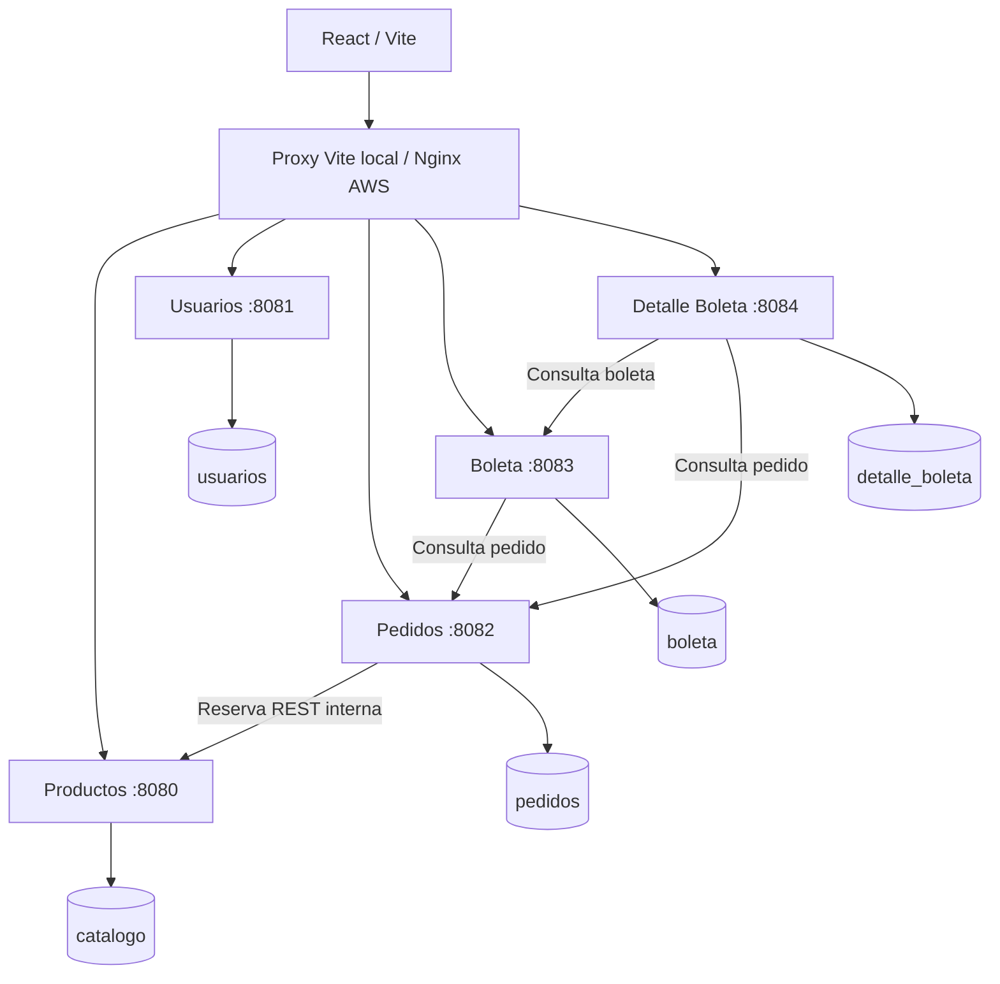

# HuertoHogar — Desarrollo Fullstack II (DSY1104)

Tienda web académica de productos agrícolas. Implementa catálogo, inventario, cuentas de usuario, pedidos y comprobantes académicos mediante React, cinco microservicios Spring Boot y MySQL.

**Alcance vigente (24-11-2026):** cumplir la evaluación EP3 y desplegar el backend en AWS EC2 según la guía del docente. La integración funcional con Galaxym queda fuera del proyecto. El catálogo puede conservar su estética ficticia; no implica pagos, despachos reales ni emisión tributaria.

> **Estado: integración y cierre académico en curso; AWS no acreditado.** Esta rama contiene los cinco backends y MySQL validado en laboratorio. La conmutación completa del frontend a los cinco servicios está en [PR #31](https://github.com/dante1603/Huerto_Hogar_2/pull/31), todavía pendiente de integración. No usar `main` como versión definitiva hasta el cierre de [PR #8](https://github.com/dante1603/Huerto_Hogar_2/pull/8).

## 1. Arquitectura



Diagrama de arquitectura objetivo: la conmutación de tráfico de React a Pedidos, Boleta y Detalle Boleta requiere integrar PR #31. Los cinco esquemas viven en una instancia MySQL 8.4; cada servicio es propietario de sus tablas y se comunica con los demás vía REST. No hay transacción SQL global entre servicios.

| Servicio / carpeta | Puerto | Esquema MySQL | Responsabilidad |
|---|---:|---|---|
| `backend/catalogo` | 8080 | `huertohogar_catalogo` | Productos, CRUD, stock y reservas internas |
| `backend/usuarios` | 8081 | `huertohogar_usuarios` | Cuentas, BCrypt, JWT y renovación de sesión |
| `backend/pedidos` | 8082 | `huertohogar_pedidos` | Pedidos, líneas, idempotencia y orquestación de reservas |
| `backend/boleta` | 8083 | `huertohogar_boleta` | Comprobante académico único por pedido |
| `backend/detalle-boleta` | 8084 | `huertohogar_detalle_boleta` | Líneas verificadas e inmutables del comprobante |

Stack: Java 21, Maven, Spring Boot, Spring Data JPA, Spring Security, JWT, Swagger/OpenAPI, MySQL 8.4, React 19, Vite 7, React Router 7 y Bootstrap 5. H2 es exclusivo de pruebas/demo; no acredita persistencia real.

## 2. Funcionalidades y perfiles

| Funcionalidad | Invitado | Cliente | Vendedor | Administrador |
|---|---|---|---|---|
| Consultar catálogo público | Sí | Sí | Sí (consulta) | Sí |
| Registrarse como cliente | Sí | — | — | — |
| Confirmar pedido y emitir comprobante propio | No | Sí | No | No |
| Consultar pedidos propios | No | Sí | — | — |
| Consultar órdenes pendientes y detalle | No | No | Sí | Sí |
| Crear, editar y eliminar productos | No | No | No | Sí |
| Administrar usuarios y roles | No | No | No | Pendiente de implementar |

El registro público asigna `CLIENTE`. Los roles `VENDEDOR` y `ADMINISTRADOR` requieren provisión autorizada. La interfaz limita rutas y acciones; Spring Security verifica autorización y propiedad de recursos independientemente del navegador. No habilitar la gestión de usuarios mediante un registro público privilegiado.

El pedido reserva stock con una clave de idempotencia UUID. Los precios se obtienen del servidor; los reintentos no deben descontar stock dos veces. La boleta y sus líneas son documentos académicos no tributarios, no pruebas de pago o entrega.

## 3. Estructura del repositorio

```text
backend/
  catalogo/         # Productos y reservas; también contiene Pedidos legado
  usuarios/         # Autenticación y cuentas
  pedidos/          # Pedidos independiente
  boleta/           # Comprobante académico
  detalle-boleta/   # Líneas de comprobante
frontend/tienda/    # Aplicación React
infra/mysql/        # Inicialización de esquemas MySQL
scripts/            # Pruebas HTTP y persistencia
docs/               # ERS, contratos, modelo, manual, evidencias
.github/workflows/  # CI
compose.yaml        # MySQL local persistente
.env.example        # Plantilla de configuración local
```

Los HTML, ZIP y prototipos históricos no son la fuente activa del sistema. No introducir sus secretos, builds ni código obsoleto en los módulos vigentes.

## 4. Ejecutar localmente

### Requisitos

- JDK 21 y Maven 3.9+.
- Node.js 22 (recomendado) y npm.
- Docker con Compose v2 para MySQL, y Python 3 para las pruebas HTTP.
- Puertos locales 3306, 5173 y 8080–8084 disponibles.

### Obtener el código de integración

```bash
git clone https://github.com/dante1603/Huerto_Hogar_2.git
cd Huerto_Hogar_2
git switch integration/fullstack-2026-11-14
```

### MySQL persistente

Desde la raíz, copiar `.env.example` a `.env` si aún no existe (`Copy-Item` en PowerShell o `cp` en Bash) y definir contraseñas distintas y robustas para `DB_PASSWORD` y `DB_ROOT_PASSWORD`. No versionar ni publicar `.env`. Si ya existe un volumen, no cambiar las contraseñas sin un procedimiento de rotación.

```bash
docker compose config --quiet
docker compose up -d mysql
docker compose ps
docker compose exec -T mysql sh -c 'MYSQL_PWD="$MYSQL_ROOT_PASSWORD" mysql -uroot < /docker-entrypoint-initdb.d/02-create-services.sql'
docker compose exec mysql mysql -uhuerto_app -p -e "SHOW DATABASES;"
```

Esperar `healthy` y comprobar los cinco esquemas. El script de provisión es idempotente; Docker solo ejecuta automáticamente la inicialización al crear el volumen vacío. **No ejecutar `docker compose down -v` sobre datos de trabajo.** Ver [guía MySQL](docs/BD_MYSQL_5_SERVICIOS_LOCAL.md).

### Configurar y arrancar los cinco servicios

Todos requieren `DB_USER=huerto_app`, `DB_PASSWORD` (la clave local), `JWT_SECRET_BASE64` (la misma clave aleatoria Base64 de al menos 32 bytes para los cinco) y `JWT_ISSUER=huertohogar-usuarios`. Nunca introducir estos valores en React.

Generar una sola clave local en un archivo ignorado por Git, únicamente si no existe; ejemplo multiplataforma (Python):

```bash
python -c "from pathlib import Path; import base64,secrets; p=Path('.jwt_local.secret'); p.open('x').write(base64.b64encode(secrets.token_bytes(32)).decode()) if not p.exists() else None"
```

Configurar `SERVER_ADDRESS=127.0.0.1` y, para cada servicio, las variables específicas de esta tabla. Las URL JDBC usan `DB_PORT=3306` por defecto; si se cambia el puerto publicado por Compose, adaptar las cinco URL.

| Servicio | Variable de puerto | `DB_URL` | Dependencias REST |
|---|---|---|---|
| Catálogo | `PORT=8080` | `jdbc:mysql://127.0.0.1:3306/huertohogar_catalogo` | — |
| Usuarios | `SERVER_PORT=8081` | `jdbc:mysql://127.0.0.1:3306/huertohogar_usuarios` | — |
| Pedidos | `PORT=8082` | `jdbc:mysql://127.0.0.1:3306/huertohogar_pedidos` | `PRODUCTOS_BASE_URL=http://127.0.0.1:8080` |
| Boleta | `PORT=8083` | `jdbc:mysql://127.0.0.1:3306/huertohogar_boleta` | `PEDIDOS_BASE_URL=http://127.0.0.1:8082` |
| Detalle | `PORT=8084` | `jdbc:mysql://127.0.0.1:3306/huertohogar_detalle_boleta` | `BOLETAS_BASE_URL=http://127.0.0.1:8083`, `PEDIDOS_BASE_URL=http://127.0.0.1:8082` |

Ejemplo en PowerShell para Usuarios, desde la raíz (introducir contraseña sin escribirla en el comando):

```powershell
$env:DB_USER = 'huerto_app'
$env:DB_PASSWORD = [System.Net.NetworkCredential]::new('', (Read-Host 'Contraseña MySQL' -AsSecureString)).Password
$env:JWT_SECRET_BASE64 = (Get-Content .jwt_local.secret -Raw).Trim()
$env:JWT_ISSUER = 'huertohogar-usuarios'
$env:SERVER_ADDRESS = '127.0.0.1'
$env:SERVER_PORT = '8081'
$env:DB_URL = 'jdbc:mysql://127.0.0.1:3306/huertohogar_usuarios'
mvn -f backend/usuarios/pom.xml spring-boot:run
```

Repetir en terminales independientes para Catálogo, Pedidos, Boleta y Detalle, usando sus propias variables y `pom.xml`. Iniciar Usuarios y Catálogo antes de probar Pedidos, y luego Boleta y Detalle. No usar el perfil `demo` para esta ejecución. Mantener `RECONCILIACION_HABILITADA=false` hasta la decisión y verificación específica de compensación.

### React

```bash
cd frontend/tienda
npm install
npm test
npm run dev
```

Abrir `http://127.0.0.1:5173`. El proxy Vite enruta Catálogo y Usuarios. **En esta rama, Pedidos aún apunta al Catálogo legado**: para probar el flujo React con los cinco servicios independientes, usar el corte de [PR #31](https://github.com/dante1603/Huerto_Hogar_2/pull/31), que incluye `package-lock.json` (usar `npm ci`) y proxy de los cinco servicios. No mezclar comprobantes del nuevo Pedidos con IDs del legado.

## 5. API REST y Swagger

Cada servicio documenta su API en `http://127.0.0.1:<puerto>/swagger-ui.html` y JSON OpenAPI en `/v3/api-docs`. Las rutas siguientes son relativas a `/api/v1`; los puertos identifican el servicio propietario.

| Servicio | Método | Ruta | Autorización |
|---|---|---|---|
| Productos | GET | `/productos`, `/productos/{id}` | Pública |
| Productos | POST | `/productos` | ADMINISTRADOR |
| Productos | PUT, DELETE | `/productos/{id}` | ADMINISTRADOR |
| Usuarios | POST | `/usuarios` | Pública; crea CLIENTE |
| Usuarios | GET | `/usuarios/{id}` | Propietario o ADMINISTRADOR |
| Usuarios | POST | `/auth/login`, `/auth/refresh`, `/auth/logout` | Credenciales / refresh según operación |
| Pedidos | POST | `/pedidos` | CLIENTE; requiere `Idempotency-Key` UUID |
| Pedidos | GET | `/pedidos/mios` | CLIENTE |
| Pedidos | GET | `/pedidos/pendientes` | VENDEDOR / ADMINISTRADOR |
| Pedidos | GET | `/pedidos/{id}` | Propietario o staff |
| Boleta | POST | `/boletas` | CLIENTE propietario; cuerpo `{pedidoId}` |
| Boleta | GET | `/boletas/{id}` | Propietario o staff |
| Detalle | POST | `/detalles-boleta` | CLIENTE propietario; cuerpo `{boletaId}` |
| Detalle | GET | `/detalles-boleta/{id}`, `/detalles-boleta/boleta/{boletaId}` | Propietario o staff |

`Authorization: Bearer <JWT>` para operaciones protegidas. HTTP 400 indica solicitud inválida; 401 autenticación inválida/ausente; 403 acceso prohibido; 404 recurso ausente o no visible según contrato; 409 conflicto de estado/datos; 503 dependencia no disponible o resultado indeterminado. No exponer `/api/v1/interno/reservas/**` al navegador: pertenece exclusivamente a Pedidos → Catálogo.

**Pendiente de implementar y validar:** mantenedor administrativo de Usuarios (`/api/v1/admin/usuarios...`), cambio de rol y desactivación lógica. Son contratos propuestos en [issue #19](https://github.com/dante1603/Huerto_Hogar_2/issues/19), no endpoints disponibles. El CRUD completo de usuarios procede del ERS original; EP3 exige CRUD REST y roles, no edición arbitraria de comprobantes.

## 6. Pruebas y evidencia

Ejecutar desde la raíz, PowerShell:

```powershell
$modules = 'catalogo','usuarios','pedidos','boleta','detalle-boleta'
foreach ($module in $modules) {
  mvn -B -ntp -f "backend/$module/pom.xml" clean verify
  if ($LASTEXITCODE -ne 0) { throw "Falló $module" }
}
```

Prueba HTTP con MySQL real, únicamente en entorno aislado: arrancar MySQL, preparar `.env` y `.jwt_local.secret`, compilar los JAR anteriores y liberar 8080–8084 antes de ejecutar `python scripts/verify_mysql_gate3.py`. El runner arranca y reinicia sus propias JVM y crea fixtures; no ejecutarlo sobre producción ni una BD compartida. Consultar [informe de Gate 3](docs/VERIFICACION_MYSQL_EP3.md).

| Verificación histórica | Evidencia | Alcance |
|---|---|---|
| 71 pruebas Java + circuito HTTP de cinco servicios | [CI #43668577173](https://github.com/dante1603/Huerto_Hogar_2/actions/runs/43668577173) | H2 aisladas; no equivale a MySQL |
| CI backend en integración | [CI #43759150779](https://github.com/dante1603/Huerto_Hogar_2/actions/runs/43759150779) | PASS al corte `10c61f0` |
| MySQL 8.4, stock, idempotencia y reinicio | [PR #30](https://github.com/dante1603/Huerto_Hogar_2/pull/30) | PASS reportado, documentación y script |
| React y comprobantes sobre MySQL | [PR #31](https://github.com/dante1603/Huerto_Hogar_2/pull/31) | PASS reportado antes del último gate; pendiente repetir E2E final |
| React y seguridad de herramientas | [CI React](https://github.com/dante1603/Huerto_Hogar_2/actions/runs/43768263920) / [CI Windows/Linux](https://github.com/dante1603/Huerto_Hogar_2/actions/runs/43768263956) | PASS al SHA `532f1a7`, no prueba E2E |
| Calidad global | [PR #8](https://github.com/dante1603/Huerto_Hogar_2/pull/8) | Último Quality Gate registrado FAIL; revisar defectos y duplicación |

Los resultados anteriores no certifican cambios posteriores. Cada candidato debe registrar SHA, comandos, resultados y limitaciones. Las capturas de navegador y AWS se toman del sistema real, nunca se simulan.

## 7. Despliegue objetivo en AWS EC2

Procedimiento del docente: Ubuntu + Java + Nginx → JAR compilado localmente y transferido → servicio `systemd` → build React → proxy inverso. Adaptación a cinco procesos; **no es evidencia de despliegue ejecutado**.

1. Verificar capacidad EC2, permisos y presupuesto. Ubuntu 24.04 / Java 21. La última instancia inspeccionada tenía aproximadamente 909 MiB RAM; medir antes de levantar las cinco JVM y MySQL. 4 GiB es una recomendación inicial, no un requisito acreditado.
2. Instalar/configurar MySQL persistente y preparar los cinco esquemas, credenciales de aplicación y backups. No publicar el puerto 3306.
3. Compilar los cinco JAR localmente y transferirlos a directorios `/opt/huertohogar/<servicio>/`. Crear usuario no privilegiado y cinco units `systemd`, con `EnvironmentFile` privados, reinicio controlado y `SERVER_ADDRESS=127.0.0.1`. Verificar `systemctl status` y `journalctl` sin divulgar secretos.
4. Compilar React (`npm ci` cuando el lockfile esté integrado, `npm run build`); publicar únicamente `dist/` en `/var/www/huertohogar/`. Usar URLs relativas bajo el mismo origen.
5. Configurar Nginx para servir SPA y redirigir exclusivamente las rutas API permitidas. Aplicar `try_files` solo al frontend; nunca responder HTML SPA a una API desconocida. Verificar `nginx -t` antes de recargar.
6. Configurar TLS/HTTPS antes de usar credenciales desde Internet. El checkout usa `crypto.randomUUID()`, que requiere contexto seguro fuera de localhost. Security Group: SSH 22 restringido a IP autorizada, HTTP 80 para redirección/validación y HTTPS 443; mantener 8080–8084 y 3306 privados.

| Ruta pública en Nginx | Destino interno |
|---|---|
| `/api/v1/productos` y subrutas | 127.0.0.1:8080 |
| `/usuarios-api/api/v1/...` | 127.0.0.1:8081, quitar solo `/usuarios-api` |
| `/api/v1/pedidos` y subrutas | 127.0.0.1:8082 |
| `/api/v1/boletas` y subrutas | 127.0.0.1:8083 |
| `/api/v1/detalles-boleta` y subrutas | 127.0.0.1:8084 |

Preservar `Authorization` e `Idempotency-Key`; configurar cabeceras de proxy y comprobar POST con `Origin` real. Swagger de cada servicio requiere prefijo exclusivo o túnel SSH: las rutas `/v3/api-docs` colisionan si se publican sin separación. Boleta y Detalle no soportan CORS cross-origin actualmente, por lo que el proxy same-origin es el contrato de despliegue elegido. No habilitar CORS universal ni publicar reservas internas.

Verificar desde un navegador externo: login, roles, CRUD, pedido, comprobante, sesión, persistencia tras reinicio y ausencia de puertos privados expuestos. La URL pública se documentará solo cuando el despliegue esté acreditado.

## 8. Seguridad y límites

- Contraseñas con BCrypt y refresh tokens opacos almacenados como hash. JWT de acceso HS256 de 30 minutos; refresh rotativo. No compartir tokens, `.env`, claves SSH o `.jwt_local.secret`.
- El secreto de firma compartido es un compromiso del MVP académico, no arquitectura ideal para producción de largo plazo. El access JWT emitido permanece válido hasta expirar; logout revoca refresh, no JWT instantáneamente.
- React usa `sessionStorage`, accesible desde JavaScript; exige revisar XSS/CSP y usar HTTPS. No confiar en controles visuales como única autorización.
- La compensación automática de reservas está desactivada por defecto. No habilitarla sin aceptación y pruebas; no ocultar fallas de dependencias ni inventar un pedido confirmado.
- Usar cuentas y datos sintéticos para demostraciones; no copiar datos reales a capturas o repositorio público.

## 9. Rúbrica y ruta de cierre

| Indicador EP3 grupal | Peso | Estado / gate pendiente |
|---|---:|---|
| Backend + BD y lógica de negocio | 8% | Cinco servicios y MySQL reportados; completar Usuarios y revalidar |
| CRUD REST + Swagger | 8% | CRUD Productos existe; agregar mantenedor Usuarios, verificar OpenAPI y pruebas |
| Integración REST frontend/backend | 6% | Cerrar PR #31 y validar tráfico a los cinco servicios |
| JWT y roles | 6% | Implementados; ampliar matriz de pruebas y gestión de roles |
| Persistencia de sesión frontend | 6% | Tests de lógica; validar recarga, expiración, renovación y logout |
| Restricciones por rol frontend | 6% | Guardas y vistas existentes; agregar gestión de Usuarios y validar tres perfiles |

El encargo grupal representa 40% de EP3 y la presentación individual 60%. El despliegue AWS es una exigencia adicional comunicada por el docente.

Orden vigente: **backend y contratos → tests Maven + REST/MySQL → completar React → validar integración → AWS → evidencias y entrega**. No ampliar alcance con pagos, telemetría o videojuegos. Ver [issue #19](https://github.com/dante1603/Huerto_Hogar_2/issues/19) para criterios detallados y avances.

## 10. Documentación y entrega

| Documento | Propósito |
|---|---|
| [ERS](docs/ERS_EP3.md) | Requisitos y alcance (borrador a actualizar) |
| [Contratos REST](docs/CONTRATOS_API.md) | APIs, permisos e invariantes (revisar secciones históricas) |
| [Arquitectura](docs/ARQUITECTURA_5_MICROSERVICIOS_EP3.md) | Separación de servicios y decisiones históricas |
| [Modelo de datos](docs/BD_MODELO_EP3.md) | Esquemas y entidades |
| [MySQL local](docs/BD_MYSQL_5_SERVICIOS_LOCAL.md) | Preparación y prueba reproducible |
| [Informe de integración](docs/INFORME_INTEGRACION_EP3.md) | Comunicación REST y evidencias |
| [Manual](docs/MANUAL_EP3.md) | Recorridos por perfil; capturas pendientes |
| [Checklist EP3](docs/ENTREGA_EP3_CHECKLIST.md) | Indicadores y artefactos exigidos |

Los documentos anteriores incluyen secciones históricas que deben sincronizarse con los cinco servicios, el alcance sin Galaxym y AWS. Para estado dinámico, prevalecen los commits, pruebas y [issue #19](https://github.com/dante1603/Huerto_Hogar_2/issues/19).

Entrega final: enlaces públicos separados a frontend y backend (confirmar aceptación del monorepo), ZIP limpios de ambos, manual con capturas reales, documento de integración y preparación de presentación. Excluir `target/`, `node_modules/`, secretos y logs. Generar todo desde el mismo commit aprobado.
